<!-- Ankur Singh | GitHub profile -->

  

  

I'm **Ankur**, a third-year Computer Science student at **GLA University** in Mathura, India. My branch is **AI & Machine Learning**.

I spend most of my coding time with Java, Python and web technologies. I like building projects that let me learn something new, from a small interface to a machine-learning model.

---

### A few projects

<table>
  <tr>
    <td width="50%" valign="top">
      <h3><a href="https://github.com/Ankursingh7/ankur-store-premium">Ankur Store</a></h3>
      
A product and e-commerce application. I've been working with the dashboard, authentication and product-management features.

      React · Express · MongoDB · JavaScript
    </td>
    <td width="50%" valign="top">
      <h3><a href="https://github.com/Ankursingh7/english_to_hindi_transformer">English → Hindi Transformer</a></h3>
      
A neural machine-translation project exploring how transformer models can translate English sentences into Hindi.

      Python · PyTorch · Hugging Face · NLP
    </td>
  </tr>
  <tr>
    <td width="50%" valign="top">
      <h3><a href="https://github.com/Ankursingh7/AI-Based-Voice-and-Motion-Controlled-Smart-Light-System">Smart Light System</a></h3>
      
An ESP32-based lighting project with voice commands, Wi-Fi control and a relay-based switching setup.

      ESP32 · Arduino · Embedded C · IoT
    </td>
    <td width="50%" valign="top">
      <h3><a href="https://github.com/Ankursingh7?tab=repositories">More experiments</a></h3>
      
Small apps, coding practice and other things I've tried while learning computer science.

      See all repositories →
    </td>
  </tr>
</table>

### Technologies

  

### GitHub at a glance

  
  

  

  

---

  Thanks for stopping by. Feel free to look through my repositories.

